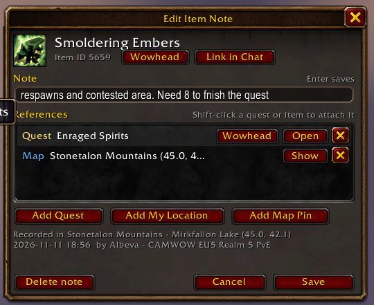
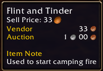
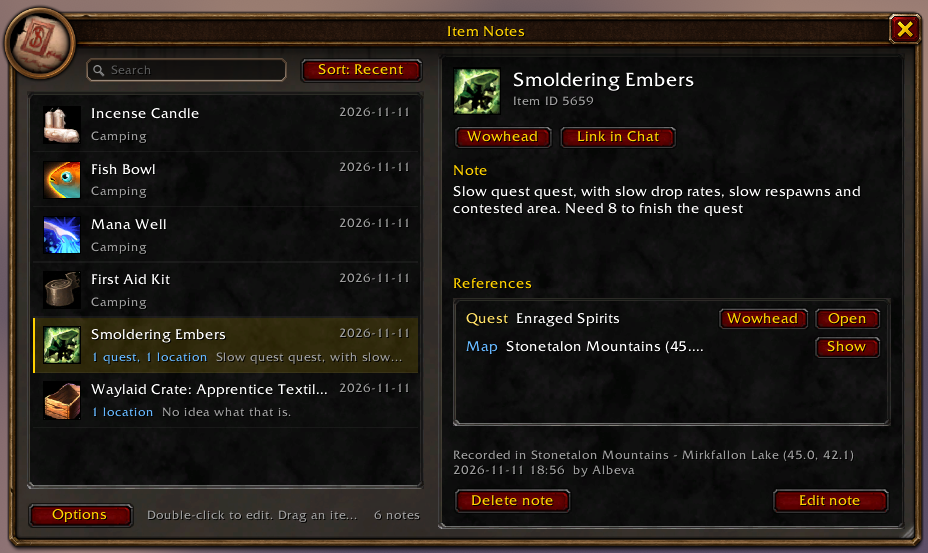

# Item Notes

A World of Warcraft addon for the **Forever** client that lets you attach personal notes to items.

Notes are stored by item ID and shared across all characters on your account. They stay even if the item is sold, banked or destroyed.

## Features

- Add a note to any item by hovering it and pressing a keybind
- Notes appear in the item's tooltip
- Attach quests, crafting recipes, spells, NPCs, macros, map locations, other items and other notes as references
- Location, time and character are recorded automatically
- One window to search, sort and manage all notes
- Copy a Wowhead link or post the item link in chat
- See how many of an item are in your bags; **Locate** opens them and searches for it

## Usage

### Add a note

Hover over an item and press your keybind. Type the note and press Enter.



While the editor is open:

- **Shift-click** a quest (tracker or quest log) or any item to attach it
- **Shift-click** a recipe in the crafting window, or a tracked recipe, to attach it
- **Shift-click** a spell in the spellbook to attach it
- **Shift-click** an NPC in the world, or its unit frame, to attach it
- **Shift-click** a note in the Item Notes window to attach that note
- **Hover and press the keybind** to attach any of these without clicking: a spell or a macro on an action bar, which a click would set off
- **Drag** an item, a spell or a macro onto the window to attach it
- **Add My Location** / **Add Map Pin** attach a map location

A new note for an item that belongs to a quest starts with that quest attached: the quest the item starts, or a quest in your quest log that uses or collects it. With Questie installed, quests that are not in your log are found too. Remove the reference if it is not the one you want.

A recipe reference opens the crafting window at that recipe, on a character that has the profession.

A spell reference shows the spell's tooltip. An NPC reference keeps the NPC's name and gives its Wowhead link; the game has nothing to open for an NPC. For a mob it stands for the kind, not the one you clicked: shift-click any Defias Bandit and the reference covers all of them. Shift-clicking an NPC also targets it, and shift-clicking a spell or a macro on an action bar also uses it: hover it and press the keybind instead.

A macro reference is kept by the macro's name, since the game gives macros no lasting ID. It shows the macro's commands and **Take** puts the macro on your cursor, on a character that has a macro by that name. Rename the macro and the reference follows it; delete the macro and the reference is removed from every note.

A reference to another note opens that note, and goes both ways: attach note B to note A and B lists A as well. Removing it from either side removes it from both. Deleting a note also removes every reference to it.

Closing the editor with Escape keeps unsaved changes: open the same item again to continue. **Cancel** discards them.

### See it in the tooltip



### Manage all notes

Type `/inotes`, or open it from the addon compartment or **Options > AddOns > Item Notes**.



Double-click a note to edit it. Drag an item onto the window to add a new note.

## Setup

The keybind is **Ctrl-Shift-N** by default. Change it under **Options > Keybindings > AddOns > Item Notes**.

## Commands

| Command | Action |
|---|---|
| `/inotes` | Open the Item Notes window |
| `/inotes <item link or ID>` | Open the editor for that item |
| `/inotes options` | Open the settings panel |

## Install

Download the latest zip from [Releases](https://github.com/albeva/itemnotes/releases) and extract it into your AddOns folder.

To run it from source instead: the addon itself lives in the `addon` folder of this repository. Copy that folder into your AddOns folder and name it `ItemNotesForever`:

```
World of Warcraft/_forever_/Interface/AddOns/ItemNotesForever/ItemNotesForever.toc
```

To keep it updated with `git pull`, clone the repository anywhere and link the folder instead of copying it.

Windows (Command Prompt):

```
git clone https://github.com/albeva/itemnotes
mklink /J "C:\Path\To\World of Warcraft\_forever_\Interface\AddOns\ItemNotesForever" "itemnotes\addon"
```

macOS:

```
git clone https://github.com/albeva/itemnotes
ln -s "$PWD/itemnotes/addon" "/Applications/World of Warcraft/_forever_/Interface/AddOns/ItemNotesForever"
```

Restart the game.

## Repository layout

| Path | Contents |
|---|---|
| `addon/` | Everything the game loads, plus lint config |
| `tests/` | Unit tests, run outside the game |
| `.pkgmeta` | Packaging config |
| `.github/workflows/release.yml` | Builds and publishes a release when a version tag is pushed |
| `.github/workflows/test.yml` | Runs the unit tests on every push |
| `art/` | Icon source (SVG) and a 512px render |
| `screenshots/` | Images for this page |

## Tests

The unit tests cover the addon's logic (`addon/Core/`): saved data, migrations, references, and everything a note looks up in the game. They run outside the game, against a stand-in for the game's API (`tests/wow.lua`), and need only [LuaJIT](https://luajit.org/) or Lua 5.1. The windows (`addon/UI/`) are not covered.

```
luajit tests/run.lua
```

Add `-v` to list every test, or name spec files to run only those. A new `tests/*_spec.lua` file is picked up by itself.

## Releasing

Pushing a version tag builds the addon package and publishes it under [Releases](https://github.com/albeva/itemnotes/releases). Commits without a tag publish nothing.

```
git tag 1.0.0
git push origin 1.0.0
```

The tag becomes the addon's version, and `CHANGELOG.md` becomes the release notes. A tag containing `alpha` or `beta` is published as a pre-release.

## License

[MIT](LICENSE)
